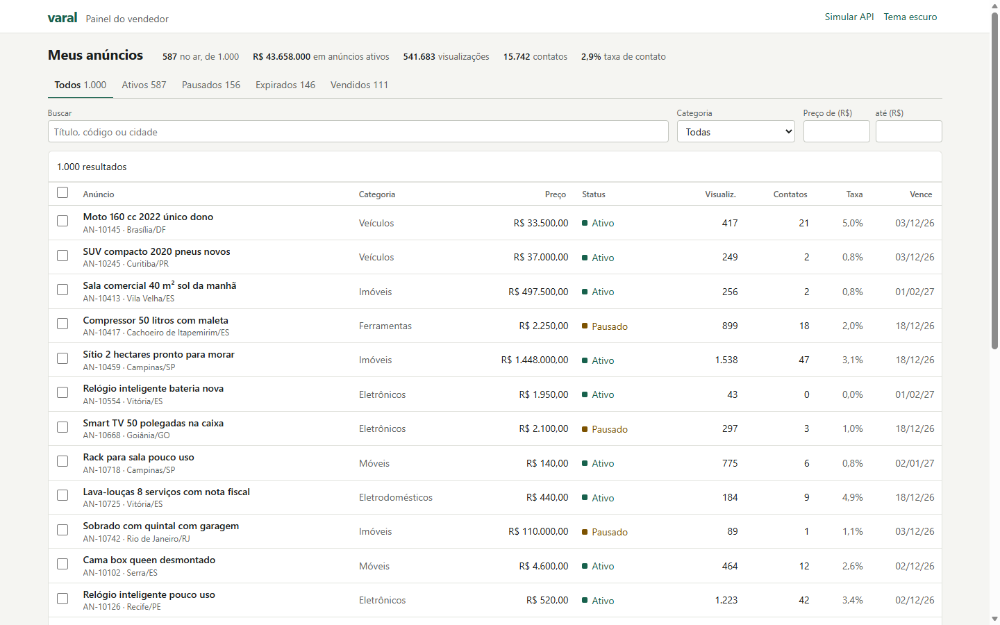
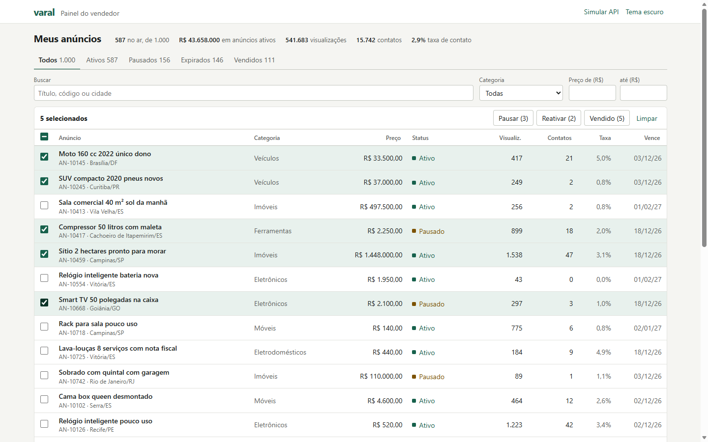
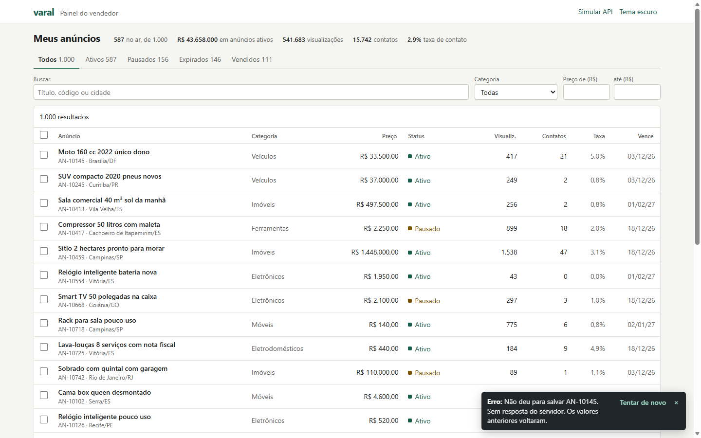
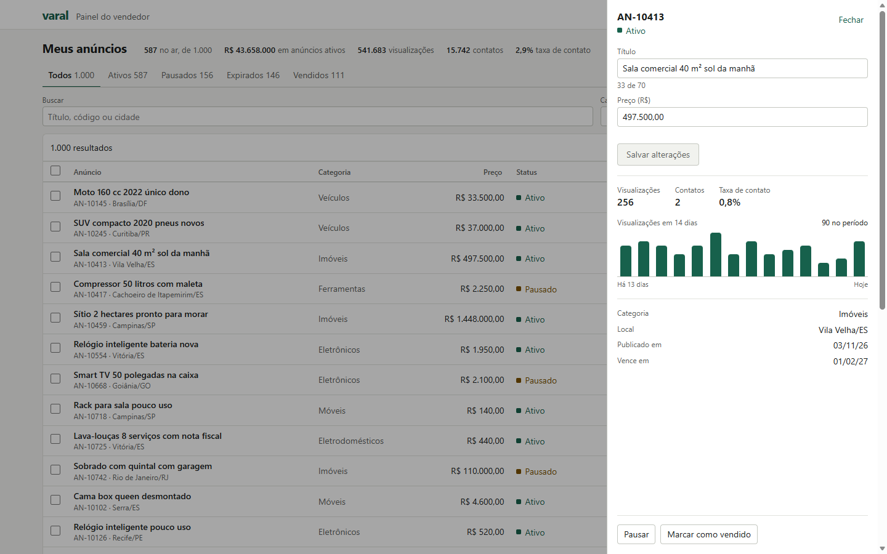
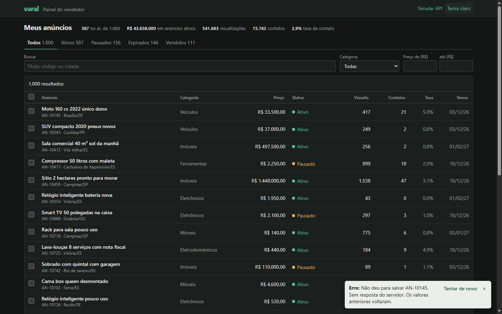
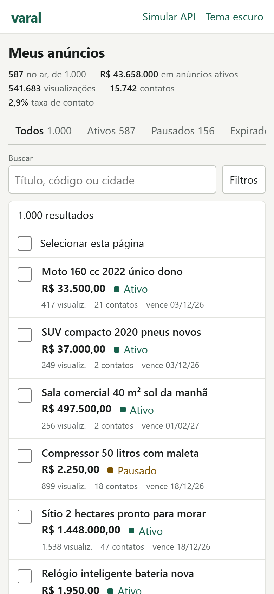
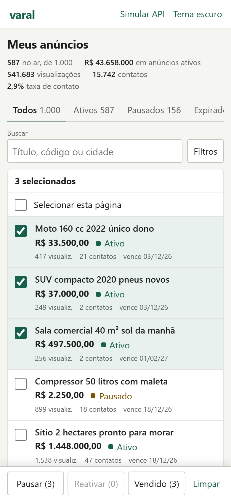
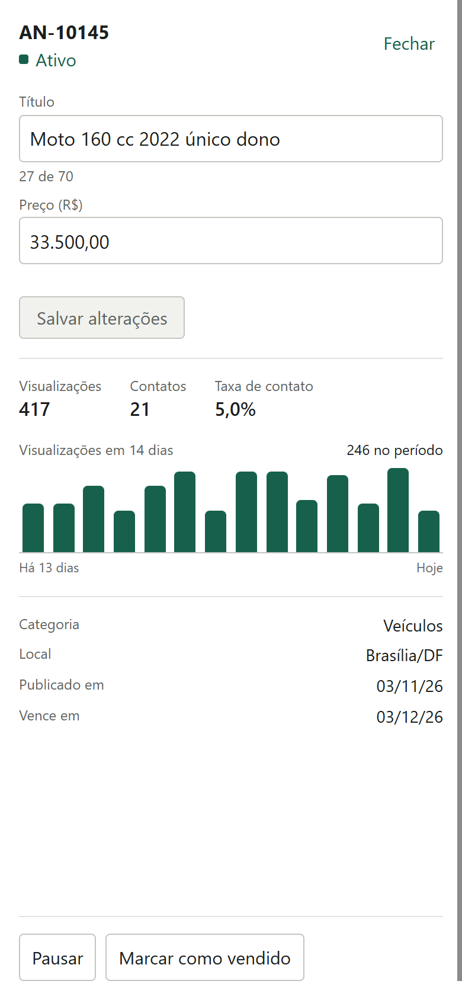

# Painel de anúncios

[](https://github.com/Kaylan00/painel-anuncios/actions/workflows/ci.yml)

Painel do vendedor do **Varal**, um marketplace de classificados fictício. Quem anuncia vê seus anúncios numa lista só, busca e filtra, muda preço e título, pausa, reativa e marca como vendido, inclusive em lote. Cada anúncio mostra visualizações e contatos.

**Demo:** https://painel-anuncios-xi.vercel.app

Os dados são 1.000 anúncios gerados no navegador por uma semente fixa, servidos por uma API falsa em memória, com latência e falha simuladas. Recarregar a página volta tudo ao início.

Para ver o rollback acontecer: abra **Simular API**, escolha falha **Sempre**, edite um preço e salve. O valor novo aparece na hora e volta ao anterior quando a resposta de erro chega.



| Ações em lote | Falha com rollback |
| --- | --- |
|  |  |

| Edição e métricas | Tema escuro |
| --- | --- |
|  |  |

No celular a tabela vira lista, os filtros ficam atrás de um botão e as ações em lote descem para a base da tela.

| Lista | Seleção | Edição |
| --- | --- | --- |
|  |  |  |

## Como rodar

```bash
npm install
npm run dev        # http://localhost:5173
npm test           # Vitest
npm run lint
npm run typecheck
npm run build
```

## Stack

React 19, TypeScript, Vite, Redux Toolkit, Vitest e Testing Library. O CSS é escrito à mão, sem biblioteca de componentes.

## Decisões técnicas

### Redux para os dados, Context para o resto

**Redux Toolkit guarda o que é dado da aplicação:** anúncios, alterações pendentes, filtros, paginação e seleção. Esses estados dependem uns dos outros (um filtro novo limpa a seleção e volta para a página 1; uma resposta da API muda a contagem das abas), muitos componentes leem recortes diferentes deles e o custo de recalcular importa com 1.000 linhas. `useSelector` com `createSelector` resolve isso: cada componente só renderiza de novo quando o seu recorte muda. A API entra como `extraArgument` do thunk, e a store é criada por uma fábrica, então cada teste tem a sua.

**Context guarda o que é só da interface:**

- **Tema:** muda raramente, afeta o `<html>` e não se relaciona com nenhum dado.
- **Avisos:** vivem segundos e carregam callbacks ("Tentar de novo"), que não são serializáveis e por isso não devem ir para a store. São dois contextos, um com a lista e outro com as funções, para que quem só dispara aviso não renderize quando a lista muda. Um teste cobre isso.

Colocar esses dois na store não traria nenhum benefício e ainda encheria o histórico de ações com ruído.

### Como funciona o rollback

A abordagem mais comum é guardar uma cópia antes de aplicar a mudança e restaurá-la se der erro. Ela falha com edições sobrepostas: se duas edições do mesmo anúncio estão em voo e a primeira falha, restaurar a cópia apaga a segunda.

Aqui os dados confirmados nunca são alterados de forma otimista. Cada envio vira uma entrada numa lista de alterações pendentes, e um selector aplica essas entradas por cima dos dados na hora da leitura:

```
pending   → mutations.push({ requestId, ids, patch })   a tela já mostra o valor novo
fulfilled → remove a entrada e grava a resposta         o dado confirmado muda
rejected  → remove a entrada                            é só isso: o rollback não restaura nada
```

Isso também resolve três casos que costumam dar problema:

- **Respostas fora de ordem:** o servidor incrementa `version` a cada escrita, e o reducer ignora resposta com versão menor que a atual.
- **Falha parcial em lote:** a API devolve `{ updated, failed }`. A entrada do lote sai, quem foi confirmado entra por `updated` e quem falhou volta sozinho. O aviso diz quantos falharam e "Tentar de novo" reenvia só esses.
- **Dado que só o servidor conhece:** reativar um anúncio vencido renova o prazo. A tela mostra o status novo na hora, e a data chega com a confirmação.

Os testes de `listingsSlice.test.ts` reproduzem esses casos com uma API cujas respostas são liberadas à mão, em qualquer ordem. `App.test.tsx` repete o fluxo pela tela.

### Como a lista grande fica rápida

- **Paginação:** são 25, 50 ou 100 linhas por vez no DOM, não 1.000.
- **Selectors em etapas:** `alterações pendentes → filtros sem status → status → ordenação → página`. Cada etapa só roda se a sua entrada mudar: trocar de página não refiltra nem reordena, reordenar não refiltra, trocar de aba não refaz a busca de texto. Os testes verificam isso com `.recomputations()`.
- **Linhas memoizadas:** uma linha sem alteração mantém a mesma referência de objeto, então o `React.memo` dela vale mesmo com alteração pendente em outra linha. Marcar uma caixa renderiza uma linha só, e há um teste para isso.
- **`useDeferredValue` na busca:** o campo responde na hora e a lista acompanha quando houver folga, sem o atraso fixo de um debounce.
- **Um DOM por vez:** desktop e celular renderizam só a sua versão, em vez de esconder a outra com CSS.
- **Code-splitting:** o painel de edição (6 kB) só baixa ao abrir o primeiro anúncio, os dados de exemplo (5 kB) ficam em chunk próprio, e React e Redux ficam num chunk de vendor (251 kB, 80 kB com gzip) que continua em cache quando só o código do app muda (32 kB, 11 kB com gzip).
- **Layout estável:** durante a carga o entorno da lista já está na tela, com o espaço dos números reservado.

Medições na demo publicada em 03/11/2026, no Edge sem limitação de CPU e com CPU 4x mais lenta:

| Ação | Normal | CPU 4x mais lenta |
| --- | --- | --- |
| Reordenar os 1.000 anúncios (mediana, até o próximo quadro) | 5,5 ms | 26,3 ms |
| Marcar uma linha (mediana, até o próximo quadro) | 4,4 ms | 12,6 ms |
| Pior evento ao digitar na busca | 16 ms | 32 ms |

Lighthouse 13.6, na mesma data:

| | Performance | Acessibilidade | Boas práticas | SEO | LCP | CLS |
| --- | --- | --- | --- | --- | --- | --- |
| Celular | 100 | 100 | 100 | 100 | 1,2 s | 0 |
| Desktop | 100 | 100 | 100 | 100 | 0,4 s | 0 |

### Regras do produto

- **Transições de status** ficam numa tabela só (`statusRules.ts`), consultada pela tela e pela API falsa. Vendido é estado final. Cada botão do lote mostra quantos selecionados podem receber a ação.
- **Validação** roda no formulário e de novo na API. O título tem de 8 a 70 caracteres, sem telefone, sem link e não pode estar todo em maiúsculas. O preço fica entre R$ 1 e R$ 20 milhões, em formato brasileiro.
- **Dinheiro** é sempre em centavos, inteiro. `"12.50"` é recusado em vez de adivinhado, porque no Brasil o ponto separa milhar.
- **Marcar como vendido** pede confirmação, porque não dá para desfazer.
- **Um filtro novo limpa a seleção**, para que uma ação em lote nunca atinja uma linha fora da tela.

## Testes

São 156 testes em 11 arquivos: reducers, selectors (incluindo memoização), rollback, API falsa, geração de dados, validação, Context, componentes e fluxos completos pela tela no desktop e no celular.

## Estrutura

```
src/
  api/                 API falsa e gerador de dados
  app/                 store e hooks tipados
  contexts/            tema e avisos
  components/          cabeçalho e avisos
  features/listings/
    model/             slices, selectors, regras e validação
    ui/                tabela, lista, filtros, painel
    useListingActions  liga as ações da store aos avisos
  test/                utilitários, incluindo a API de respostas manuais
```

O Varal e todos os anúncios são fictícios.
